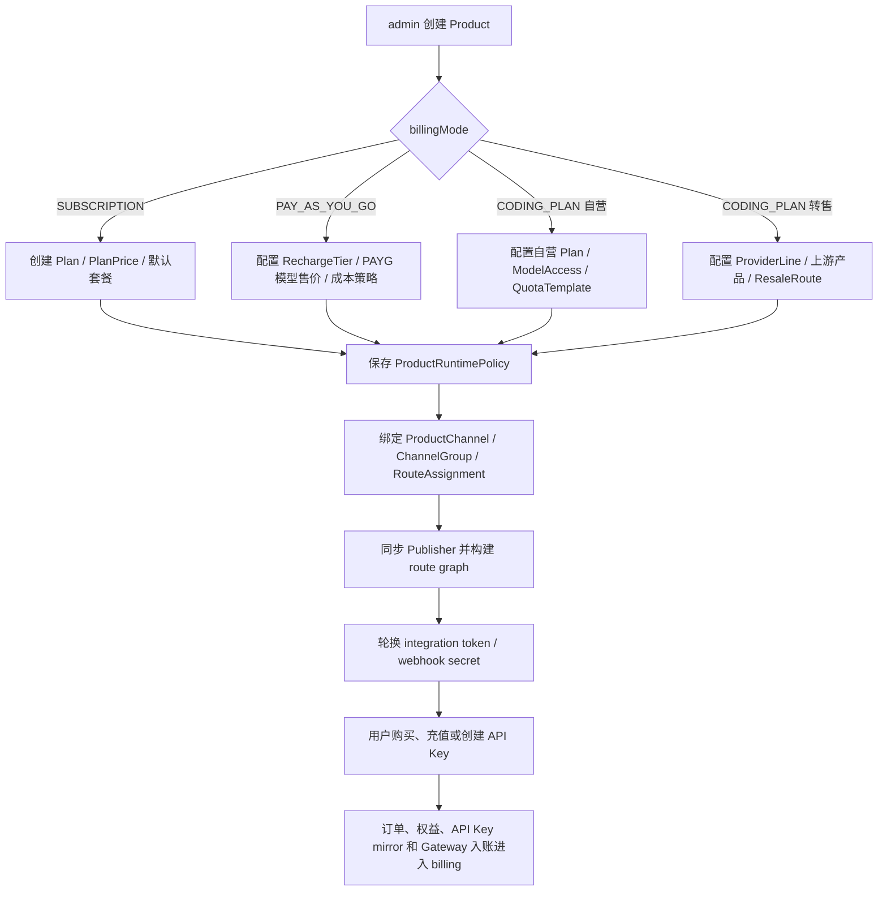

# codesphere-billing 新产品接入与管理业务逻辑

本文档基于 `origin/test` 分支截至 2026-06-22 的代码现状整理，说明 `codesphere-billing` 作为产品、计费、供给、路由和运行时同步权威服务时，一个新产品从接入到上线运营的业务规则。

## 1. billing 的职责

`codesphere-billing` 是产品接入链路的事实源。admin 负责管理入口，user 负责用户门户和 API Key 本地状态，但以下数据和行为以 billing 为准：

- Product、Plan、PlanPrice、BoosterPack、RechargeTier。
- 订阅、订单、支付、退款、余额、积分、账务交易。
- API Key 计费镜像、Gateway 入账、模型售价、供应商成本。
- ProductRuntimePolicy、Channel、ProductChannel、ProductChannelGroup、RouteAssignment。
- CodingPlan 自营配额、供应商转售、上游权益和使用趋势。
- Publisher/Gateway 运行时同步任务。
- 产品配置 webhook 同步任务。

主要代码入口：

- `apps/api/src/billing/product.service.ts`：产品创建、默认产品解析、集成状态、runtime policy、token/secret 轮换。
- `apps/api/src/billing-runtime/billing-admin.controller.ts`：admin/user internal 产品、套餐、API Key mirror、计费管理入口。
- `apps/api/src/billing-runtime/product-route-admin.controller.ts`：产品渠道、渠道组、route assignment 和 route graph 管理入口。
- `apps/api/src/product-route/product-route.service.ts`：产品路由业务规则和 Publisher 同步。
- `apps/api/src/billing-runtime/product-portal.controller.ts`：产品 portal 读取套餐、模型、渠道、余额、订阅等产品域数据。
- `apps/api/src/billing-runtime/saas-provisioning.service.ts`：外部 SaaS 默认套餐开通和 provision。
- `apps/api/src/integration/product-config-sync/product-config-sync.service.ts`：产品配置变更 webhook 同步。

外部 SaaS provision 的逐步开通、虚拟 Key、Publisher/Gateway 同步和余额判定细节，详见 [外部 SaaS Provision 链路说明](./saas-provisioning-flow.zh-CN.md)。

## 2. 产品模型

`Product` 是新产品的根对象，核心字段包括：

- `name`、`slug`、`description`、`icon`：展示和集成标识，`slug` 唯一。
- `webhookUrl`：外部产品接收配置变更的 webhook 地址。
- `defaultPlanId`：默认套餐，用于订阅产品和 SaaS provision。
- `integrationTokenHash` / `integrationTokenPrefix` / `integrationTokenRotatedAt`：产品接入令牌。
- `webhookSecretEncrypted` / `webhookSecretPrefix` / `webhookSecretRotatedAt`：产品 webhook 签名 secret。
- `billingMode`：`SUBSCRIPTION`、`PAY_AS_YOU_GO`、`CODING_PLAN`。
- `codingPlanFulfillmentMode`：仅 CodingPlan 使用，`platform_model_package` 或 `provider_resale`。
- `isActive`、`sortOrder`、`deletedAt`：上下架、排序和软删除。

Product 关联：

- 套餐与定价：`Plan`、`PlanPrice`、`BoosterPack`、`RechargeTier`、`PaygModelPricingPolicy`。
- 用户和账务：`UserSubscription`、`Order`、`BalanceTransaction`、`CreditTransaction`、`ApiKey`、`TokenUsage`。
- 权益：`TenantProductEntitlement`、`CodingPlanEntitlement`、`CodingPlanProviderEntitlement`。
- 运行时：`ProductRuntimePolicy`、`ProductChannel`、`ProductChannelGroup`、`RouteAssignment`。

## 3. 产品创建和默认产品解析

### 3.1 创建/更新

admin 通过 `/api/internal/billing/admin/products` 写入产品，最终落到 `ProductService.create/update`。

业务规则：

- 创建时必须提供 `name` 和 `slug`。
- `slug` 在数据库唯一，不应作为可频繁变更的展示字段使用。
- `billingMode` 默认为 `SUBSCRIPTION`。
- `codingPlanFulfillmentMode` 只有 `CODING_PLAN` 产品有意义；非 CodingPlan 产品应为空。
- `defaultPlanId` 更新时，billing 会校验默认套餐属于该产品。
- 删除产品是软删除：设置 `deletedAt`，并在列表和默认解析中排除。

### 3.2 默认产品解析

user-api 会调用 `GET /api/internal/billing/admin/products/default` 获取默认产品。

解析规则：

- 调用方必须指定 `billingMode`。
- 如果传入 `productId` 或 `productSlug`，billing 要求产品存在、未软删、处于 active，并且匹配请求的 `billingMode` 和可选 fulfillment mode。
- 如果没有显式产品 ID/slug，billing 在 active 产品中按 `billingMode` 和 fulfillment mode 查找。
- 隐式查找必须唯一；没有匹配或匹配多个都会报错，避免 user 侧猜错产品。

这条规则决定了多产品并存时必须在前端环境变量或请求参数中显式指定产品。

## 4. 集成凭证和接入状态

产品接入状态来自 `ProductService.getIntegrationStatus`。

它会返回：

- endpoints（与当前发布的 22 个 Partner OpenAPI 操作同源）：
  - `/partner/v1/tenants/provision`
  - `/partner/v1/product/current`
  - `/partner/v1/catalog`
  - `/partner/v1/catalog/products`
  - `/partner/v1/catalog/plans`
  - `/partner/v1/catalog/booster-packs`
  - `/partner/v1/catalog/model-access`
  - `/partner/v1/catalog/model-route-policies`
  - `/partner/v1/catalog/models`
  - `/partner/v1/catalog/channels`
  - `/partner/v1/payment/create`
  - `/partner/v1/payment/orders`
  - `/partner/v1/payment/orders/{id}`
  - `/partner/v1/payment/orders/{id}/status`
  - `/partner/v1/payment/methods`
  - `/partner/v1/billing/current-subscription`
  - `/partner/v1/billing/credits`
  - `/partner/v1/billing/credits-summary`
  - `/partner/v1/billing/credit-transactions`
  - `/partner/v1/billing/transactions`
  - `/partner/v1/billing/daily-summary`
  - `/partner/v1/billing/monthly-summary`
  - 当前不发布 `/partner/v1/catalog/bundles`、`/partner/v1/catalog/model-pricing` 或新建 `BUNDLE` 订单；历史组合包订单仍可查询。
- credentials：
  - 是否已有 integration token。
  - integration token prefix 和 rotatedAt。
  - 是否已有 webhook secret。
  - webhook secret prefix 和 rotatedAt。
- requirements：
  - `requiresDefaultPlan`：订阅产品需要默认套餐。
  - `requiresWebhookUrl`：订阅产品需要 webhookUrl。
  - `apiKeyDefaultBinding`：PAYG 产品需要 API Key 默认绑定。
- virtualKey：
  - `saas:${product.slug}:virtual` 默认命名的虚拟 key 统计。
- checklist：
  - `hasPlans`
  - `hasDefaultPlan`
  - `hasWebhookUrl`
  - `hasIntegrationToken`
  - `hasWebhookSecret`
  - `hasActiveVirtualKey`
  - `hasApiKeyDefaultBinding`

凭证轮换：

- integration token 使用 `rpi_${slug}` 前缀生成，billing 只保存 hash、prefix 和轮换时间，明文只返回一次。
- webhook secret 使用 `rwh_${slug}` 前缀生成，billing 加密保存密文、prefix 和轮换时间，明文只返回一次。

## 5. 三种产品模式

### 5.1 SUBSCRIPTION

订阅产品有两条需要区分的链路：

- 用户门户购买链路：`Product -> Plan -> PlanPrice -> Order -> Subscription/Entitlement`。
- 外部 SaaS provision 链路：`Product -> default/free Plan -> TenantProductEntitlement -> saas virtual ApiKey -> Publisher/Gateway`。

接入要求：

- 产品 `billingMode=SUBSCRIPTION`。
- 至少有一个 active plan。
- 如需注册后默认开通，`defaultPlanId` 必须指向该产品下有效套餐。
- 如需外部 SaaS 同步，必须配置 `webhookUrl`、integration token 和 webhook secret。
- 套餐价格可通过 `PlanPrice` 配置多币种；`Plan` 上的价格字段保留为默认 fallback。

运行逻辑：

- user onboarding outbox 调 `ensureDefaultFreePlan` 时，billing 按默认产品/默认计划开通免费计划。
- 用户购买套餐时创建订单，支付完成后创建或更新订阅、period 和 entitlement。
- 外部产品调用 `/partner/v1/tenants/provision` 时，`SaasProvisioningService` 会确保 user/tenant mirror、默认套餐订阅、`TenantProductEntitlement`，并创建或复用名为 `saas:{productSlug}:virtual` 的 API Key。产品身份只从 integration token 解析，不从请求体传入。
- 虚拟 Key 创建后会调用 Publisher 同步 KeyMeta；同步 KeyBalance 时，因为该 Key 绑定的是非 PAYG 产品，billing 会查 active subscription period 的积分池，而不是 workspace 钱包余额。
- 产品集成状态中的 `virtualKey.activeCount` / `hasActiveVirtualKey` 是按产品和默认 key 名称检查是否至少已有 active `saas:{productSlug}:virtual`；它表示 SaaS provision 链路已经打通过，不代表每个用户/租户都已开通。
- 如果 provision 请求自定义 `key.name`，该 Key 仍可被创建和同步，但默认 `hasActiveVirtualKey` checklist 不一定命中。
- 订阅、积分、余额、交易和 token usage 均带 product 维度，支持后台和用户侧按产品查询。

### 5.2 PAY_AS_YOU_GO

PAYG 产品依赖 `Product -> RechargeTier / PaygModelPricingPolicy -> ApiKey mirror -> GatewayBillingEvent -> Balance` 链路。

接入要求：

- 产品 `billingMode=PAY_AS_YOU_GO`。
- 配置有效充值面额 `RechargeTier`。
- 配置模型售价 `PaygModelPricingPolicy`，可按 product/model/time window 生效。
- 配置供应商成本 `ProviderModelCostPolicy`，用于成本和毛利。
- 用户 API Key 创建时必须能解析到唯一 PAYG 产品，或由前端/请求显式传 `productId`。

运行逻辑：

- 用户在 user 侧创建 API Key，本地进入 `PROVISIONING`，outbox 调 billing mirror。
- billing 保存 `ApiKey` 计费镜像并同步 Publisher/Gateway。
- Gateway usage event 到达 billing 后，按 `productId`、模型售价、成本策略、余额/allowance 和幂等 key 入账。
- 余额、交易、日报/月报和 GatewayBillingEvent 都以 billing 记录为准。

### 5.3 CODING_PLAN / platform_model_package

自营 CodingPlan 依赖 `Product -> Plan(planType=coding_plan) -> ModelAccess -> PlanQuotaTemplate/Rule -> CodingPlanEntitlement -> TokenPlan API Key` 链路。

接入要求：

- 产品 `billingMode=CODING_PLAN`。
- `codingPlanFulfillmentMode=platform_model_package`。
- 套餐绑定该产品，`planType=coding_plan`。
- 上架套餐必须至少有一个 active model access。
- 上架套餐必须绑定至少一个 active quota template。
- 配额展示和执行依赖 `PlanQuotaTemplate` 和 `PlanQuotaRule`，不依赖 Plan 上的散字段限流。

运行逻辑：

- 用户购买自营套餐后获得 `CodingPlanEntitlement`。
- user 侧创建 TokenPlan 专属 API Key 时必须带 entitlementId。
- billing entitlement 决定 productId、tenantId、fulfillmentMode 和配额池。
- 自营 entitlement 的 API Key 可不挂 key 级默认 RPM，配额由套餐共享池执行。
- 每个 entitlement 的专属 API Key 数量上限由 user 侧事务控制，billing mirror 后进入运行时。

### 5.4 CODING_PLAN / provider_resale

转售 CodingPlan 依赖 `Product -> ProviderLine -> ProviderProduct -> Plan -> CodingPlanResaleRoute -> ProviderEntitlement` 链路。

接入要求：

- 产品 `billingMode=CODING_PLAN`。
- `codingPlanFulfillmentMode=provider_resale`。
- 配置供应商线路 `CodingPlanProviderLine`，包含 provider、adapter、API base、认证方式和加密凭证。
- 同步上游产品目录 `CodingPlanProviderProduct`。
- 创建转售套餐，并通过 `CodingPlanResaleRoute` 绑定 plan、providerLine 和 upstreamProductId。

运行逻辑：

- 用户购买转售套餐时，user/payment 代理会先查询已有 active provider_resale entitlement，阻止同套餐有效期内重复购买。
- 支付完成后 billing 根据 resale route 调供应商创建订单或权益。
- 成功后生成 `CodingPlanProviderEntitlement` / `CodingPlanEntitlement`。
- 用户侧可查看已购套餐、上游 key 和使用趋势。
- 供应商履约失败可由后台重试。

## 6. Runtime Policy

`ProductRuntimePolicy` 是产品运行时意图，字段包括：

- `credentialSource`：`platform_pool` / `provider_entitlement`。
- `allowedProviderIds`、`allowedChannelIds`：运行时 provider/channel 范围。
- `modelScopeMode`：`plan_configured` / `product_allowlist` / `upstream_inherited`。
- `allowedModels`：产品模型白名单。
- `fallbackPolicy`：`none` / `within_product` / `within_provider` / `platform_default`。
- `runtimeBillingMode`：`payg_balance` / `subscription_credits` / `token_plan_quota` / `included_upstream`。
- `routeStrategy`：`priority` / `weight` / `latency` / `least_busy`。
- `protocolStrategy`：`auto` / `passthrough_only`。
- 桥接策略、桥接原因、负责人、过期时间、审批信息。
- `status` 和 `revision`。

保存规则：

- `GET /runtime-policy` 会返回产品、显式策略标记、序列化后的 policy、channels 和可选枚举。
- `PUT /runtime-policy` upsert `ProductRuntimePolicy`，revision 递增。
- 更新后调用 Publisher 同步，把产品运行时意图推到 Gateway/Publisher。

## 7. 产品渠道、路由组和投放

产品路由由 `ProductRouteService` 管理。

### 7.1 ProductChannel

`ProductChannel` 将全局 `Channel` 绑定到 `Product`：

- 一个产品内同一个 channel 不能重复绑定。
- `allowedModels` 会校验在 channel 的模型集合内。
- `deniedModels` 可为空或为 channel 模型子集。
- 可配置 `status`：`active`、`disabled`、`testing`。
- 可配置 `isDefault`、`priority`、`weight`、`maxRpm`、`maxTpm` 和 metadata。

创建、更新、删除后都会触发产品路由同步。

### 7.2 ProductChannelGroup

`ProductChannelGroup` 将多个 ProductChannel 编组：

- 策略支持 `weighted_failover`、`priority_failover`、`round_robin`、`cost_first`、`latency_first`。
- 状态支持 `active`、`disabled`。
- 一个产品下只有一个 default group；设置新 default 会清除其它 default。
- 成员角色支持 `primary`、`fallback`、`shadow`。
- 成员按 priority 升序、weight 降序参与编排。

### 7.3 RouteAssignment

`RouteAssignment` 将某类用户流量定向到组或渠道：

- `subjectType` 支持 `USER` 和 `USER_SEGMENT`。
- `targetType` 支持 `GROUP` 和 `PRODUCT_CHANNEL`。
- `mode` 支持 `ONLY` 和 `PREFER`。
- 可配置 `modelPattern`、`clientCompatibility`、priority、startsAt、endsAt、isActive、reason 和 metadata。
- 服务会校验 subject 是否存在、target 是否属于该产品、时间范围是否合法。

### 7.4 Delivery Setting 一键创建

`createDeliverySetting(productId, input)` 是后台投放向导的聚合入口：

- 要求产品存在且至少选择一个 channel。
- 校验 channel 不重复且存在。
- 创建渠道组；如果 audience 是全量或 group 标记为 default，则清除旧默认组。
- 为每个 channel 创建或复用 ProductChannel。
- 创建 group members，默认第一个为 `primary`，后续为 `fallback`。
- 如果配置了 audience，则创建 route assignment。
- 确保 runtime policy 存在。
- 同步 route 到 Publisher，并构建 route graph。

## 8. 配置同步和运行时发布

产品相关变更有两类同步：

1. Publisher/Gateway 同步：
   - runtime policy 变更。
   - 产品渠道、渠道组、成员、route assignment 变更。
   - API Key mirror、余额、模型、渠道等运行时资源变更。
   - 同步任务可通过 PublisherSyncJob 查看、重试和 replay。

2. 产品配置 webhook 同步：
   - 产品有 `webhookUrl` 和 webhook secret 时，ProductConfigSyncService 可以生成签名 webhook。
   - job 记录状态、重试次数、错误和 payload。
   - payload 会按 productSlug 投递给外部产品。

## 9. 用户和工作区镜像

user-api 不直接写 billing 主表，而是通过 internal provisioning：

- 注册或登录时，user 侧确保个人工作区，并调用 billing mirror workspace。
- 工作区成员新增、角色变更、停用时，user 侧同步 membership snapshot。
- 用户注册后，onboarding outbox 调 billing `ensureDefaultFreePlan`。
- API Key 创建、启停、吊销由 user outbox 调 billing mirror/revoke。

billing 因此可以在不拥有用户认证主数据的情况下进行：

- 订阅归属。
- workspace balance/allowance。
- API Key 入账。
- tenant/product entitlement。

## 10. 新产品上线核对清单

通用检查：

- Product 已创建，slug 稳定且唯一。
- 产品处于 active 前，套餐、价格、充值或转售配置已完整。
- runtime policy 已保存且 Publisher 同步成功。
- 产品渠道和默认路由组已配置。
- route graph 能构建成功。
- 集成 token 和 webhook secret 已轮换并交付给接入方。
- 产品集成 checklist 没有阻断项。

订阅产品：

- 有 active plan。
- defaultPlanId 属于该产品。
- webhookUrl、token、secret 已配置。
- SaaS provision 场景下，有 active `saas:{productSlug}:virtual` 虚拟 Key，并能成功同步 Publisher KeyMeta/KeyBalance。
- 用户购买后订阅、period、entitlement 和交易可查询。

PAYG 产品：

- 有 active recharge tier。
- 有核心模型售价策略。
- 有 provider cost 策略。
- API Key mirror 后可被 Publisher/Gateway 激活。
- GatewayBillingEvent 能按 productId 入账。

自营 CodingPlan：

- 有 self-managed CodingPlan product。
- 自营套餐绑定 product。
- active model access 非空。
- active quota template 非空。
- entitlement 专属 API Key 可以创建、查询、启停和吊销。

转售 CodingPlan：

- provider line 已配置凭证并测试通过。
- 上游产品目录已同步。
- 转售套餐绑定 product。
- resale route 指向有效 provider line 和 upstream product。
- 支付后能创建 provider entitlement，失败可重试。

## 11. 推荐业务流程

## 12. 边界和风险

- 不允许 user 或 admin 直接修改 billing 数据库。
- 不允许靠 user 前端猜测多产品中的默认产品；多 active 产品必须显式配置产品 ID 或 slug。
- 不应在未配置 route graph 和 runtime policy 的情况下开放产品。
- 不应删除仍有订阅、订单、API Key 或路由引用的产品；产品下线优先使用 `isActive=false`。
- 转售套餐不能绕过供应商产品目录手写上游 productId。
- integration token 和 webhook secret 轮换后需要同步接入方，否则产品 portal 或 webhook 会失败。
- Gateway 入账、余额扣减和财务报表以 billing 记录为准，admin/user 展示只能作为视图。
