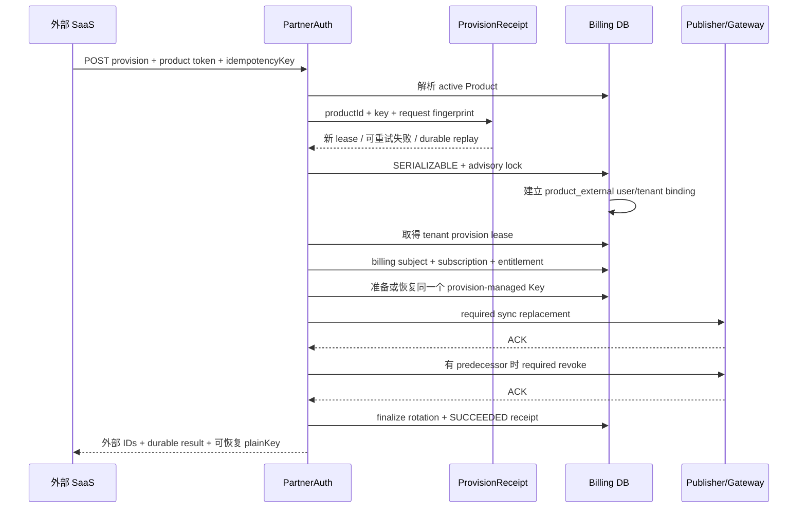

# 外部 SaaS Provision 链路说明

本文档说明外部 SaaS 如何通过 Partner OpenAPI 建立产品范围内的用户/租户绑定，开通默认权益，并安全创建或轮换虚拟 API Key。

## 1. 接口与机器契约

```http
POST /partner/v1/tenants/provision
Authorization: Bearer <product_integration_token>
Content-Type: application/json
```

也兼容 `x-product-token` 和 `x-billing-product-token`。产品身份只从接入令牌解析；请求中出现 `productId` 或 `productSlug` 会返回 400。

权威机器契约是：

```text
apps/api/openapi/partner-openapi.json
```

- 重新生成：`pnpm openapi:generate`
- 检查代码与静态契约一致：`pnpm openapi:check`
- 非生产环境默认提供 `/docs` 和 `/openapi.json`；生产环境仅在 `OPENAPI_DOCS_ENABLED=true` 时提供

请求体采用严格对象合同：未声明字段、拼写错误和不支持的状态修改都会返回 400。

## 2. 身份模型：外部 ID 不是 Billing 全局主键

外部产品的 `user.id` 和 `tenant.id` 只在当前 token 产品的命名空间内有效。Billing 不再把它们直接当作全局 `User.id` / `Tenant.id`，而是通过两张绑定表解析内部随机 ID：

```text
(productId, externalUserId)   -> internal User.id
(productId, externalTenantId) -> internal Tenant.id
```

对应数据表：

- `product_external_user_bindings`
- `product_external_tenant_bindings`

这带来四条硬约束：

1. 两个产品可以安全使用相同的外部用户或租户字符串，不会发生全局主键碰撞。
2. 后续 Partner 账务和订单接口只接受当前产品已建立的外部绑定，不接受“碰巧等于内部 UUID”的未绑定 ID。
3. 用户与租户绑定必须属于同一产品；显式 team tenant 要求调用用户是 active `owner/member`，个人 tenant 仍要求 canonical owner。
4. 响应中的 `userId` / `tenantId` 始终回写为调用方的外部 ID，不泄露内部主体 ID。

能被单一产品明确证明归属的历史 provision 数据会迁移为显式绑定并标记为不可写快照。Partner 可以继续使用这些绑定，但不能借 provision 修改历史共享用户或租户资料。若同一个 legacy internal user 同时被证明属于多个产品，migration 会主动中止；不能把这种共享的 user-global Grant 身份自动解释为任一产品的独占身份。

### 2.1 生产 activation gate 与回滚边界

身份 V2 会为新外部 ID 写入随机内部 User/Tenant；旧二进制仍把外部 ID 当全局主键，因此生产环境的新主体写入由 `PARTNER_IDENTITY_V2_WRITE_ENABLED` 控制。生产未配置时等同 `false`，非生产未配置时默认开启。

### Migration 前置审计

必须在执行 `prisma migrate deploy` **之前**，用与 migration 相同的证据规则执行以下只读审计。证据仅包括 canonical tenant owner，或当前产品精确命名的 active `saas:{productSlug}:virtual` Key 所属 active member；没有时间窗口或“最近创建用户”的猜测。

```sql
WITH candidate_user_bindings AS (
  SELECT DISTINCT
    entitlement.product_id,
    tenant.owner_user_id AS user_id
  FROM tenant_product_entitlements entitlement
  JOIN tenants tenant
    ON tenant.id = entitlement.tenant_id
  JOIN tenant_members membership
    ON membership.tenant_id = tenant.id
   AND membership.user_id = tenant.owner_user_id
   AND membership.status = 'active'
  WHERE entitlement.source = 'saas_provision'

  UNION

  SELECT DISTINCT
    entitlement.product_id,
    api_key.user_id
  FROM tenant_product_entitlements entitlement
  JOIN products product
    ON product.id = entitlement.product_id
  JOIN api_keys api_key
    ON api_key.tenant_id = entitlement.tenant_id
   AND api_key.product_id = entitlement.product_id
   AND api_key.deleted_at IS NULL
   AND api_key.name = 'saas:' || product.slug || ':virtual'
  JOIN tenant_members membership
    ON membership.tenant_id = entitlement.tenant_id
   AND membership.user_id = api_key.user_id
   AND membership.status = 'active'
  WHERE entitlement.source = 'saas_provision'
)
SELECT
  user_id,
  array_agg(DISTINCT product_id ORDER BY product_id) AS product_ids
FROM candidate_user_bindings
GROUP BY user_id
HAVING COUNT(DISTINCT product_id) > 1;
```

通过标准是 **0 rows**。出现任意结果时不要部署 migration：先暂停 Partner 写流量，逐条确认 user-level Grant/余额和各产品的真实归属，为每个产品拆分或显式分配独立内部用户，并同步修正 tenant membership、产品虚拟 Key 和权益引用。完成财务对账后重新执行审计，直到返回 0 rows。migration 内还有同一 hard-stop；遗漏 preflight 会直接导致 `migrate deploy` 失败，而不会带病回填。

安全上线顺序：

1. 保持 gate 为 `false`，完成上述前置审计和必要的数据拆分。
2. 部署 additive migration。迁移建表/索引、回填可证明属于单一产品的历史 `saas_provision` 绑定，不修改历史 `tenant_members.role`。
3. 在所有实例部署 V2 二进制，gate 仍为 `false`。此时既有回填主体可读；任何需要创建随机主体或迁移非 canonical team owner 的请求返回 503。
4. 确认 migration 全部成功、`product_external_*_bindings` 唯一约束无冲突、历史产品 token 的只读查询和既有主体 provision smoke test 通过，并确认没有 V1 实例仍接收流量。
5. 显式设置 `PARTNER_IDENTITY_V2_WRITE_ENABLED=true` 并滚动所有实例。随后新主体采用随机内部 ID，历史非 canonical provision owner 会在其下一次 V2 provision 时收敛为 active `member`。

回滚规则：

- gate 开启前可以回滚应用二进制；migration 是 additive，且没有提前降级成员角色。
- gate 开启后是 **roll-forward-only**。一旦产生任意 V2 新绑定，不得回滚到把 external ID 当主键的 V1 二进制，否则会重复创建主体、Key 和权益。
- gate 开启后的故障处置是关闭入口流量、修复并前滚 V2；不要通过把 gate 改回 `false` 后回滚 V1 来恢复。

## 3. Tenant scope 规则

`tenant.id` 在 schema 层可选，但运行时根据 token 产品条件校验：

- `SUBSCRIPTION`、`PAY_AS_YOU_GO`、转售 `CODING_PLAN`：必须传显式 `tenant.id`。
- self-operated `CODING_PLAN`，即 `billingMode=CODING_PLAN` 且 fulfillment 为 `platform_model_package`：允许 user-only provision。服务会为该产品和外部用户创建或复用稳定的 personal tenant 绑定。

user-only 只适用于免费开通、API Key 和支持该 scope 的读取。`POST /partner/v1/payment/create` 对所有产品都要求显式外部 `tenantId`，因为 user-api 的 purchase-eligibility 校验必须验证真实的外部租户成员关系。需要购买时，应先用显式 `tenant.id` provision。

self-operated Coding Plan 即使传入显式 team tenant，也只把 team 用于 active membership / purchase-eligibility 校验；订阅、Key、订单列表、余额和用量读取统一解析到该用户的产品专属 personal runtime tenant。响应仍回写调用方传入的外部 team ID。`provider_resale` 不使用这套双 tenant 语义：它留在显式 tenant scope，必须已有 active resale entitlement，provision 不会替 Partner 免费调用上游履约。

## 4. 请求合同

```json
{
  "idempotencyKey": "provision:tenant-10001",
  "user": {
    "id": "user-123",
    "email": "alice@example.com",
    "phone": null,
    "nickname": "Alice",
    "sourceUpdatedAt": "2026-07-23T08:00:00.000Z"
  },
  "tenant": {
    "id": "tenant-123",
    "name": "Alice Team",
    "type": "team"
  },
  "ensureFreePlan": true,
  "key": {
    "allowedModels": ["gpt-4.1"],
    "budgetCents": 100000,
    "rotate": false
  }
}
```

关键字段：

| 字段 | 规则 |
| --- | --- |
| `idempotencyKey` | 必填；trim 后 8–128 字符，只允许字母、数字、`.`、`_`、`:`、`-`；作用域是 token 产品 |
| `user.id` | 必填的外部用户 ID；不是 Billing 全局用户主键 |
| `user.email/phone/nickname` | 可选的产品来源快照 |
| `user.sourceUpdatedAt` | 可选 ISO 8601 时间，不能超过当前时间 5 分钟 |
| `user.isActive` | 不在外部合同中；显式传入会因严格 schema 返回 400，Partner 不能修改账号启停状态 |
| `tenant.id` | 按上一节条件必填；是当前产品的外部租户 ID |
| `tenant.type` | 仅允许 `personal` 或 `team` |
| `ensureFreePlan` | `SUBSCRIPTION` / self-operated `CODING_PLAN`：省略、`null` 或 `true` 时确保默认免费权益，`false` 跳过。`PAY_AS_YOU_GO` 和 `provider_resale`：不自动开通，显式 `true` 返回 400。未知 Coding fulfillment mode fail closed |
| `key.name` | 可省略；如传入，必须精确等于 `saas:{token-derived-productSlug}:virtual` |
| `key.allowedModels` | 可选模型白名单；非 `null` 时必须包含 1–200 项。空数组返回 400；每个模型还必须同时存在于产品真实可路由/可见 surface 与当前 plan 的 active ModelAccess 中 |
| `key.budgetCents` | 可选正整数预算，单位 cents |
| `key.rotate` | 显式轮换当前 provision-managed Key；修改模型白名单或预算时必须设为 `true` |

## 5. 幂等回执与重试

每次请求先建立 `saas_provision_receipts` 回执，唯一键为：

```text
(token-derived productId, idempotencyKey)
```

服务会对规范化后的 product、user、tenant、key 和 `ensureFreePlan` 计算请求指纹。

- 同一 key + 相同规范化请求：重放同一个 durable result。
- 同一 key + 不同请求指纹：HTTP 409，不会复用或修改旧结果。
- `PENDING` 且 10 分钟执行 lease 仍有效：HTTP 409，表示同一请求正在执行。
- `FAILED` 或过期的 `PENDING`：同一个 key 可以重新取得 lease 并继续。
- `SUCCEEDED`：直接读取持久化结果，不重复创建订阅，也不再次轮换 Key。

回执在 Publisher 同步前就会记住已准备的 API Key ID。即使进程在外部调用期间失败，后续使用同一 key 重试也会继续处理同一个 Key，而不是生成第二个凭证。

调用方的正确重试策略：

1. 为一个逻辑 provision 生成一个稳定 `idempotencyKey`。
2. 网络超时、502 或 503 后仍使用原 key 和相同请求。
3. 收到“正在执行”的 409 时退避后重试，不要换 key。
4. 只有开始新的业务操作时才生成新 key。

## 6. 身份事务与并发控制

用户和租户绑定在 `SERIALIZABLE` 事务中建立，并对以下身份键获取 PostgreSQL transaction advisory lock：

- `product + external user`
- `product + external tenant`
- user-only personal tenant

数据库唯一约束和锁共同保证并发请求不会为同一个外部主体创建多个内部身份。

身份事务完成后，链路还要执行账务、订阅、权益和 Publisher 调用。为避免这些跨边界步骤并发交错，服务在 `product_external_tenant_bindings` 上取得 10 分钟 tenant provision lease，并在关键步骤续租。回执 lease 与 tenant lease 是两层不同的保护：

- 回执 lease：串行化同一产品下的同一个幂等请求。
- tenant lease：串行化同一产品租户的完整 provision 副作用。

lease 冲突或失效都会 fail closed，返回 409。

## 7. 默认订阅与权益

对 `SUBSCRIPTION` / self-operated `CODING_PLAN`（`platform_model_package`），当 `ensureFreePlan` 省略、为 `null` 或为 `true` 时：

1. 优先使用 `Product.defaultPlanId` 指向的同产品 active plan。
2. 未配置时，查找同产品所有 legacy 价格为 0，且不存在任何 active `PlanPrice` 月/季/年正价的 active plan；只要任一币种/周期为正价就不能自动免费开通。
3. 普通订阅通过 `SubscriptionLifecycleService.activateIfAbsent`；self-operated Coding Plan 通过独立的 Coding entitlement activate-if-absent，二者都把 `provisionReceiptId` 作为持久化幂等归属。
4. 套餐有 `monthlyCredits` 时，以 `saas_provision:{subscriptionPeriodId}` 为幂等键发放 quota。
5. upsert `TenantProductEntitlement`，写入 `status=active`、`source=saas_provision` 和对应 plan。

免费激活与付费激活使用相同的 tenant/product advisory lock。完成回执前会在锁内重新读取当前 active 权益；如果付费权益已经替换免费权益，回执收敛到付费权益，且不会向已被替换的免费 period/entitlement 发 quota。因此，重试不会重复建立权益或重复发放默认积分，也不会覆盖/续期已有付费权益。

`SUBSCRIPTION` / self-operated `CODING_PLAN` 显式 `ensureFreePlan=false` 时 `subscription=null`；服务仍会确保 billing subject、产品权益和虚拟 Key。

`PAY_AS_YOU_GO` 不通过 provision 创建订阅：省略、`null` 或 `false` 时继续建立 entitlement 和 Key，响应 `subscription=null`；显式传 `true` 会返回 400，避免把订阅积分语义错误套到 PAYG 产品。

`provider_resale CODING_PLAN` 同样不会由 provision 自动创建免费权益：省略、`null` 或 `false` 时要求调用主体已经持有 active 转售 entitlement，响应沿用该权益；显式传 `true` 返回 400，避免绕过真实上游履约。未知或未配置的 Coding fulfillment mode 一律 fail closed。

## 8. 虚拟 API Key 的创建与轮换

固定 Key 名称：

```text
saas:{productSlug}:virtual
```

Key 只能由 provision 链路管理，记录带有 `managedBy=saas_provision`。数据库对以下维度建立“最多一个 active Key”的部分唯一索引：

```text
userId + tenantId + productId + name
```

如果同名 Key 不是 provision-managed，服务返回 409，不会接管其他来源的凭证。

### 8.1 新建或复用

- 已有 active Key 且未要求轮换：复用同一 Key，并重新执行 required Publisher 同步。
- 调用方显式改变 `allowedModels` 或 `budgetCents`，但没有 `rotate=true`：返回 409。
- 没有 active Key：在序列化事务和 API-Key advisory lock 下创建新 Key。

Billing 长期只保存 Key hash 和 prefix。为了处理“Key 已创建、HTTP 响应丢失”，新明文还会使用 `ENCRYPTION_KEY` 加密保存最多 15 分钟。

### 8.2 轮换状态机

轮换不会先删除旧 Key 再碰运气同步。执行顺序是：

1. 在事务中创建 replacement，记录 `rotationPredecessorId`，并把 predecessor 标记为本地 `ROTATING`。
2. required 同步 replacement 到 Publisher/Gateway，等待成功 ACK。
3. required 远程 revoke predecessor，等待成功 ACK。
4. 仅在两个 ACK 都成功后，事务性把 predecessor 标记 `REVOKED` 并软删除，同时清除 replacement 的 predecessor 关系。

任何 Publisher 步骤失败时：

- 错误写入 replacement 的 `mirrorError`。
- predecessor 关系和可重试状态保留，不会把不确定状态伪装成成功。
- provision 回执转为 `FAILED`。
- 同一 `idempotencyKey` 重试会恢复已记住的 replacement，并继续同步/撤销，不会再次 rotate。

## 9. 15 分钟明文恢复窗口

`plainKey` 不是长期字段，也不再是“只可能返回一次”的易丢语义：

- 首次成功响应会返回新 Key 明文。
- 如果响应丢失，在创建后 15 分钟内使用相同幂等 key 精确重放，可恢复同一个 Key 的明文。
- 15 分钟后仍会返回同一个 `apiKey.id` 和 `prefix`，但 `plainKey=null`，不会偷偷创建或轮换新 Key。
- 回执 JSON 永远不保存明文；重放时只从 API Key 的短期加密密文恢复。
- 服务启动时执行一次过期密文清理，运行期间每分钟清理一次。

如果调用方在恢复窗口后仍未取得明文，应发起一个新的、明确的轮换业务操作，使用新的 `idempotencyKey` 且设置 `key.rotate=true`。

## 10. 响应合同

```json
{
  "code": 0,
  "message": "ok",
  "data": {
    "userId": "user-123",
    "tenantId": "tenant-123",
    "productId": "prod-123",
    "productSlug": "example-product",
    "apiKey": {
      "id": "key-123",
      "prefix": "rk-12345678",
      "plainKey": "rk-full-secret",
      "created": true,
      "rotated": false
    },
    "subscription": {
      "id": "subscription-123",
      "planId": "plan-free",
      "created": true
    }
  }
}
```

返回语义：

- `userId` / `tenantId` 是调用方的外部 ID。user-only 请求的 `tenantId` 为 `null`，内部 personal tenant 不会暴露。
- `created` / `rotated` 描述原始 durable provision 操作。成功重放仍返回相同布尔值，不表示“本次 HTTP 重放又执行了一次”。
- `plainKey` 是否非空取决于 15 分钟恢复窗口。
- `subscription=null` 表示请求跳过默认套餐。

## 11. 错误处理

| HTTP | 含义与处理 |
| --- | --- |
| `400` | 严格字段校验失败、非 user-only 产品缺 `tenant.id`、默认套餐缺失等；修正请求后使用符合业务语义的 key |
| `401` | 产品接入令牌缺失、无效、停用或已轮换 |
| `403` | 外部用户/租户未绑定当前产品，或绑定主体不可用 |
| `404` | 产品范围内的关联资源不存在 |
| `409` | 幂等指纹冲突、请求仍在执行、绑定冲突、lease 冲突、Key 状态冲突；按错误原因修正或退避重试 |
| `429` | IP 或产品令牌限流；遵循 `Retry-After` 和数值 `retryAfter` |
| `502` | 上游响应异常；保留原 key 重试 |
| `503` | Publisher、加密配置或共享限流后端不可用；保留原 key 重试 |
| `500` | 未预期错误；不要盲目换幂等 key |

## 12. 时序图



## 13. 上线验收清单

1. Product active、slug 稳定，integration token 已安全交付。
2. 需要自动订阅时已配置同产品默认/free plan。
3. `ENCRYPTION_KEY` 已配置，且 Publisher/Gateway required 同步可用。
4. 外部 SaaS 为每个逻辑请求生成稳定且可追踪的 `idempotencyKey`。
5. 普通产品显式传 `tenant.id`；self-operated user-only 的限制已被接入方理解。
6. 同一请求并发调用只出现一个内部 user/tenant binding、一个 active managed Key。
7. 模拟 HTTP 响应丢失，在 15 分钟内重放可得到同一个 Key 明文。
8. 超过 15 分钟重放返回同一 ID/prefix 且 `plainKey=null`。
9. 模拟 Publisher 同步/撤销失败，确认状态保留且同 key 重试不生成第二个 Key。
10. 用相同 key 修改请求内容，确认返回 409。
11. 需要支付的产品先用显式 external tenant provision，再创建订单。
